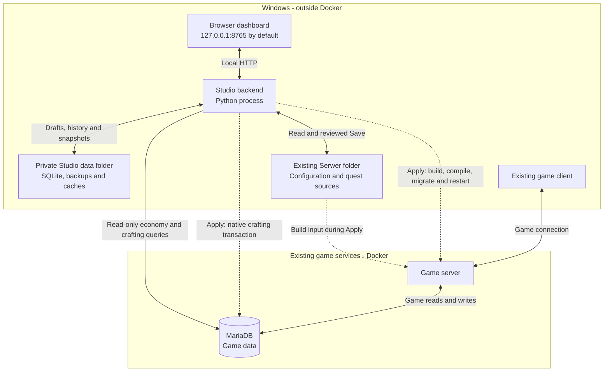
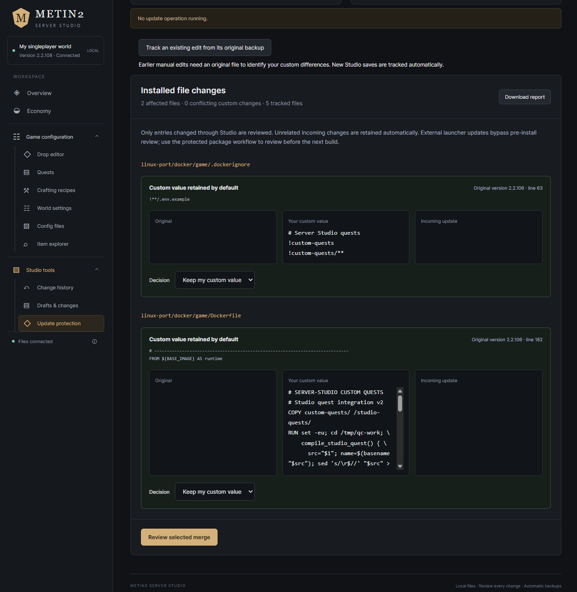

# Metin2 Singleplayer Studio

**beta-1.0.0** · A local dashboard for an already installed Metin2 Singleplayer server.

Search and edit drops, create quests, manage crafting at existing NPCs, inspect item usage and review the economy. Changes have previews, backups, history and protection for custom edits when the game is updated.

Studio is installed **beside the game**, in its own folder. Installing or opening it does not install the game, change gameplay files or restart a running server. Saving an edit and applying it to the game are separate actions.

## Architecture overview

Everything runs on your computer. The browser talks to Studio's local Python service. Studio reads your existing game installation and keeps its own history in a separate data folder on Windows. The game server and its MariaDB database use the game's existing Docker setup.



Solid arrows show normal requests and data access. Dashed arrows represent work performed during an explicit **Apply**. This is a simplified view; the game package has other supporting services. GitHub renders the diagram above; the workflow below also describes it in plain text.

- **Review:** inspect the proposed values and source diff. This does not write game files or deploy anything.
- **Save:** write the reviewed configuration files with backups. A named change set holds edits in Studio until you publish that set. Saving does not restart the game; native crafting changes remain in a Studio-owned JSON configuration until Apply.
- **Apply:** build the saved configuration, compile custom quests, run the required settings migration and recreate the game container. Native crafting customisations are written to MariaDB in a guarded transaction while the game is stopped. Unsaved drafts and unpublished change sets are excluded. Connected players disconnect when the game restarts.

The existing client connects directly to the game server. Closing Studio leaves the game running. Economy observations read existing game data and save aggregate snapshots in Studio's SQLite files outside Docker. Custom quests are optional server-side `.quest` scripts compiled by the existing build; their creation also adds a backed-up compiler integration. Studio does not patch engine or client binaries.

See [Databases and Docker](#databases-and-docker) for storage details and [Your first edit](#your-first-edit) for the editing workflow. Game updates have a separate [custom-change review](#updating-the-game-or-studio) before Apply.

## See what you can do

Real dashboard captures from an installed world. Item names, available recipes and economic values depend on your game package and saved world. Expand an example to see its editor; click any image to view it at full size.

**Follow the economy across progression stages.** Separate GM accounts, inspect Yang, item stock, recorded sales and upgrade activity, then export a report. Coverage notes explain what the existing game data can establish.


<details>
<summary><strong>Edit Metin, monster and chest drops</strong></summary>

Choose a target, adjust reward items, quantities and base parameters, inspect shared pools and review changes before saving. A base parameter is not always the final in-game drop probability.


</details>

<details>
<summary><strong>Find the right item without knowing its ID</strong></summary>

Filter by category or function: bonus changers, bonus adders, scrolls, potions, materials and more. Search by name or ID when useful; hover an item for its description.


</details>

<details>
<summary><strong>Check where an item is already used</strong></summary>

Open **Where used** from a reward or the catalog to inspect its configured drops, crafting and other indexed references before adding another source.


</details>

<details>
<summary><strong>Create a quest with guided fields</strong></summary>

Choose a hunt, item turn-in or exchange template. Select the NPC, objectives, requirements, rewards and repeat cooldown; inspect the generated quest source and dialogue preview before saving. New quests add opt-in server-side scripts and require compilation during Apply.


</details>

<details>
<summary><strong>Manage crafting at existing NPC menus</strong></summary>

Filter by NPC, edit ingredients, output quantities, success chance and Yang cost, or create and clone recipes. Studio selects the existing Cube or native crafting system for that menu. This example shows Baek-Go's native potion recipe.


</details>

<details>
<summary><strong>Review a rollback before confirming it</strong></summary>

Select a saved change in **Change history**, inspect its before/after diff and decide whether to revert. Confirmation creates another backup; applying the reverted configuration remains a separate step. The capture shows a preview only.


</details>

<details>
<summary><strong>Keep custom changes when the game updates</strong></summary>

Compare the original, your custom value and the incoming update for tracked edits. Green **Custom value retained by default** entries keep your value unless you choose otherwise; they are not unresolved conflicts. In this example, two files are affected and there are zero conflicting custom changes. Review the selected merge before saving, then Apply separately.



</details>

## Requirements and compatibility

- **Windows 10/11** and **Python 3.10+**. Python 3.13 was used for local game integration checks. Download Python from [python.org](https://www.python.org/downloads/windows/); enable its launcher/PATH option if offered.
- An existing, working **Metin2 Singleplayer Linux/Docker server package**, with a `Serwer` directory containing `files/`, `linux-port/docker/` and `VERSION`. This beta was validated against package **2.2.106**. Other Metin2 distributions, remote servers, WSL-only paths and standalone client folders are not supported by this release.
- The game's normal Docker Desktop / Docker Compose setup. Keep using its launcher to start the game. Docker is needed for live economy data, native crafting and Apply; file-based editors remain usable with Docker stopped.
- Write access to the selected server and Studio folders.

**No pip packages, npm packages, Node.js, separate database server, game reinstall or engine/client patch is needed to run Studio.** Node.js is only used for developer checks. The repository contains Studio code, not the game or its assets.

## Install on a computer where the game already works

1. Download the portable ZIP from [Releases](https://github.com/CosTeiiRa/mt2-singleplayer-studio/releases/tag/beta-1.0.0), or use **Code → Download ZIP**. Extract it fully into a permanent folder, for example `C:\Tools\Metin2Studio`. Do not run the files from inside the ZIP or place Studio inside `Serwer`.
2. Confirm Python is installed. If a terminal is available, `py -3 --version` or `python --version` should show Python 3.10 or newer.
3. Double-click **Install Studio.bat**. Choose the **existing `Serwer` folder** in the folder picker. You can also select its `Metin2 Singleplayer` parent folder. Setup validates the package files, saves your choice locally and creates a desktop shortcut. It does not copy or replace game files, start Docker, build images or restart the game.
4. Double-click **Start Studio.bat**, or the **Metin2 Server Studio** desktop shortcut. The dashboard opens at **http://127.0.0.1:8765**. Starting an already running matching instance reuses it.
5. For live economy data and native crafts, start the world with its **existing game launcher**, wait until it is healthy, then refresh the relevant page in Studio.

If you skip step 3, **Start Studio.bat** opens setup on its first run. No administrator launch is normally necessary. **Stop Studio.bat** stops only Studio; the game remains running. The batch files use a process-local PowerShell execution policy; no system-wide policy change is needed.

Your first launch uses the current game files as its starting point. It does not import someone else's world, recipes, quests, credentials or economic history. Existing manual customisations remain present, but earlier custom differences cannot be reconstructed without an original backup; see **Update protection → Track an existing edit**.

### Configure from PowerShell instead

Run these commands from the extracted Studio folder:

```powershell
powershell -NoProfile -ExecutionPolicy Bypass -File .\Setup-Studio.ps1 -ServerRoot "D:\Games\Metin2 Singleplayer\Serwer" -NoShortcut -NonInteractive
powershell -NoProfile -ExecutionPolicy Bypass -File .\Launch-Studio.ps1 -NoBrowser -NonInteractive
```

Choose another local port by adding **`-Port 8766` to Setup-Studio.ps1**; then use `http://127.0.0.1:8766`. Setup remembers the port. To check configuration without changing any files:

```powershell
python setup_studio.py --check
```

For a terminal-only session, you can run `python server.py --root "D:\Games\Metin2 Singleplayer\Serwer" --port 8766`. Stop it with Ctrl+C. The advanced `--state` option selects an existing Studio data folder; do not share one folder between different worlds. `METIN2_STUDIO_SERVER_ROOT` is also supported for developer/integration-test sessions. Explicit CLI arguments take precedence.

## Your first edit

1. Open **Drop editor**, **Quests**, **Crafting recipes** or a configuration submenu.
2. Find items by name, ID, category or function. Hover to read descriptions; **Where used** shows existing references.
3. Make a small edit and click **Review changes**. Check the before/after values and source diff.
4. **Save changes** writes a backed-up configuration. A working change set stages it until that whole set is published. Unsaved drafts and staged changes are excluded from Apply.
5. The top bar shows **Apply changes (N)** for pending saved files, plus a pending game package update if present. Click it to inspect the list and then choose **Build & restart**. **Players disconnect at the restart.** With zero pending changes the control is disabled. **Validate build only** compiles/builds without restarting or writing native crafting rows.

For an existing working world, use the game's backup feature before your first Apply. Studio's configuration history does not replace a world/database backup. A build failure keeps the running game; a later migration/database/start failure can leave it stopped, with a diagnostic in the Apply log.

## What is included

| Area | Features |
|---|---|
| Drops and chests | Metin/boss/monster filters, searchable items, quantities, weights/chances, shared pools and combined-source views |
| Item catalog | Category/function filters, descriptions, icons and existing drop/craft/shop/refinement references |
| Quests | A quest library, guided editing of supported existing fields, hunt/turn-in/exchange templates, cooldowns, NPC guidance, cloning and removal of Studio quests |
| Crafting | Existing Cube and native NPC menus, automatic system selection, ingredients/reward/chance/cost/requirements, cloning, shared-definition warnings and removal |
| Economy | GM-separated views, stock/trade/price/activity indicators, snapshots, experiments, event journal and CSV/JSON exports with coverage limits |
| Configuration | Submenus for gameplay settings, spawns/maps, fishing, alchemy and supported advanced files |
| Change management | Drafts, named change sets, reviewable backups/rollbacks, pending Apply counts and custom-difference update protection |

See the [operator guide](docs/USER_GUIDE.md) for mechanics, source coverage and limitations. Normal configuration edits use the game's existing systems. **New quests are opt-in server-side scripts:** saving one adds `.quest` source and a backed-up compiler integration; generated templates use the existing game logging API for their limited item-flow records. They do not change engine or client binaries. Native crafting saves a Studio JSON configuration; its database changes happen only during Apply.

## Databases and Docker

The game and Studio use separate storage:

| Component | Database | Location and purpose |
|---|---|---|
| Existing game | MariaDB | Runs in the game's Docker setup; stores accounts, characters, inventories, shops, game logs and native crafting. Studio connects to this existing service. |
| Studio workspace | `workspace.sqlite` | A local Windows file holding drafts, tracked custom changes, change sets, deployment records and preferences. |
| Studio economy history | `economy.sqlite` | A local Windows file holding economic snapshots, journal notes and balancing experiments. |

**SQLite is outside Docker.** Studio's Python process accesses these files directly; SQLite needs no separate server or container. They live in the selected Studio data folder, normally `data/worlds/<id>/`. Setup prints its exact path; migrated installations can keep an older or explicitly chosen data folder.

With Docker stopped, Studio can still open file-based editors and saved Studio history. Live economy data and live native crafting require the game's MariaDB service; Apply requires Docker. Stopping Studio leaves the game and its database running. Back up Studio's data folder and the game/world database separately.

### Scalability

This beta is designed for one local owner managing one world. Each Studio installation has independent local databases; players do not write to Studio's SQLite files when they kill monsters or trade. By default, Studio collects aggregate economy snapshots every 60 minutes while running, has a 180-day snapshot retention setting and caches live observations for up to 60 seconds.

SQLite suits this workload, but it permits only one writer per database at a time; see [SQLite's deployment guidance](https://www.sqlite.org/whentouse.html). A shared service with many simultaneous administrators would need changes to Studio's architecture as well as its storage.

Larger economic histories would benefit from indexed history queries and more compact snapshot processing. Analytics also query the game's MariaDB, so performance depends on game data, queries and hardware. Some collection limits deliberately bound work—for example, 20,000 sales records per observation—with incomplete coverage flagged in the report. Functional tests do not establish a maximum supported player count.

## Local data, backups and privacy

- Local setup is saved in **`data/studio-settings.json`**. It contains the selected server path, port and data path, not database credentials.
- By default each selected game folder gets its own **`data/worlds/<id>/`**. This holds `workspace.sqlite`, `economy.sqlite`, `backups/`, cached sources and reviewed update packages. Setup prints the exact location.
- Preserve the **whole `data/` folder** when updating Studio. Crafting reconciliation, rollback, drafts and history depend on it. A selected data folder is bound to its server path to prevent using another world's history accidentally.
- Backups can include the game's original `.env`, so treat local data as private. `data/`, databases, logs, credentials and built ZIPs are excluded from Git. The release builder also excludes them.
- Studio listens only on `127.0.0.1`. It is a local owner tool; do not expose it through a public bind, proxy or port forwarding.

If migrating from an older Studio installation, retain its data folder and configure the same game with `Setup-Studio.ps1 -ServerRoot "...\Serwer" -StateDir "...\old-studio\data" -NoShortcut -NonInteractive`. This preserves the old history instead of beginning a separate one.

## Updating the game or Studio

**Game update:** use Studio's **Update protection** workflow to stage/review the package and choose what happens only to affected custom differences. Unrelated package changes are retained. Native crafting also reviews conflicts only in customised database fields. If you update with the game's external launcher, scan installed files in Studio afterward; Studio cannot intercept an external updater. Build/Apply remains a separate step.

**Studio update:** stop Studio, extract the new release over the same Studio folder while preserving `data/`, then start it again. If installing into a new folder, copy your private `data/` folder across before setup/start. Git users can pull a newer version while keeping the ignored data. Updating Studio does not apply game configurations automatically. If moved, run **Create-DesktopShortcut.ps1** to create a shortcut to the new location.

## Troubleshooting

| Problem | What to do |
|---|---|
| Python not found / Store alias opens | Install Python from python.org with its launcher/PATH option, reopen the terminal and rerun Install Studio.bat. Both `py -3` and `python` are supported. |
| Missing `files/items.json`, SQL dump or Cube files | Select the server's **Serwer** folder, not the game client. Setup lists missing files. Arbitrary Metin2 distributions are unsupported. |
| Docker/economy/native crafting unavailable | Start Docker Desktop and the world using the existing launcher, wait for healthy services, then Refresh. No new Docker stack is installed by Studio. |
| Port already in use / wrong world opens | Close that Studio instance, or configure another port with `Setup-Studio.ps1 -ServerRoot "...\Serwer" -Port 8766`. The launcher checks the world/data identity before reusing an instance. |
| Data belongs to another server | Choose the correct game folder or a new data folder. Do not overwrite another world's binding/history. |
| Studio fails to start | Read `studio.err.log` in the data folder printed by setup. Run `python setup_studio.py --check` to verify the remembered paths. |
| An update conflicts with my edit | Review Update protection or **Crafting → Review crafting conflicts**, select the desired values, save and Apply separately. |
| I want to undo an edit | **Studio tools → Change history → Review rollback → Revert saved changes**. Review newest related edits first; Apply loads the rollback. |

## Development and verification

Runtime code uses Python's standard library and plain HTML/CSS/JavaScript. There is no dependency installation or frontend build step.

```powershell
python -m unittest discover -s tests -v
node --test tests/catalog.test.js tests/icons.test.js tests/navigation.test.js tests/quest_help.test.js
python tools/check_project.py
```

Self-contained tests run without the game. Integration tests are skipped unless a supported existing installation is configured or `METIN2_STUDIO_SERVER_ROOT` is set. They copy selected game files into disposable, ignored test folders; game assets are not committed. Actual builds, compiled quest behavior, in-game NPC rendering and real database transactions require separate local checks; CI does not claim to test a complete game installation.

The [CI workflow](.github/workflows/ci.yml) checks Python 3.10/3.13 on Windows/Linux and JavaScript syntax/tests. `python tools/build_release.py` creates a portable ZIP and SHA-256 file in ignored `dist/`, from tracked sources only. A `beta-*` tag matching `VERSION` triggers a prerelease with that ZIP and checksum after checks pass. See [release notes](docs/RELEASE_NOTES.md) and [project review](docs/BETA_REVIEW.md).
