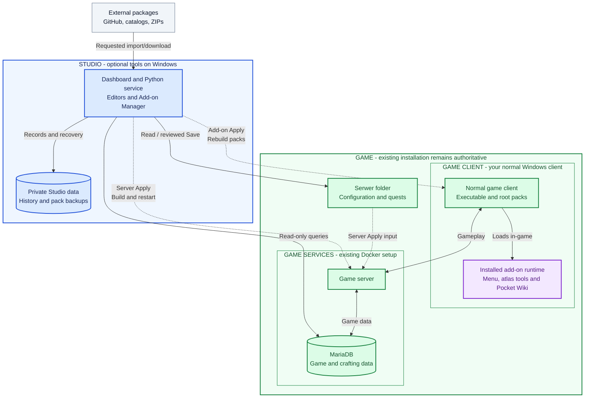

# Metin2 Studio

**beta-1.11.0** · One local application for the server workspace, client add-ons and world atlas.

Studio brings server editing and client add-on management into one local dashboard.
Search and edit drops, create quests, manage crafting at existing NPCs, inspect
item usage and review the economy. Add in-game tools such as **Boss Atlas** and
**Pocket Wiki** through the same application, using your normal game client.

The game remains the source of truth. Studio keeps drafts, custom changes,
add-on records and backups in its own data folder. Game updates take priority;
you decide afterwards which custom changes and add-ons to reapply.

Use **Install Studio.bat** to select an existing server, then **Start Studio.bat**. Server editing and the atlas have no third-party Python dependencies. To enable client pack installation/rebuilding, use **Install Add-on Support.bat** once; it installs pinned wheels into this project's `.vendor` folder. This optional feature needs 64-bit Python 3.11+ and binary wheels for that version. Restart Studio after installing support.

See [the merged workflow and migration guide](docs/MERGED_STUDIO.md), [creator guide](docs/ADDON_CREATOR_GUIDE.md), [repository workflow](docs/ADDON_REPOSITORIES.md) and [integration verification](docs/ADDON_TESTING.md). The [roadmap](docs/ADDON_ROADMAP.md) records implemented features separately from acceptance evidence. Users choose which packages and publishers they trust; publisher verification and signing are outside the platform scope. A hosted catalog is optional; broader logged-in gameplay acceptance remains pending.

Studio is installed **beside the game**, in its own folder. Installing or opening it does not install the game, change gameplay files or restart a running server. Saving an edit and applying it to the game are separate actions.

## Small beta scope

This is a **limited beta candidate for one local owner on Windows**. The initial
target is Metin2 Singleplayer server **2.2.110** / client **2.0.114**, with 64-bit
Python **3.13**. See the [beta checklist and evidence](docs/BETA_REVIEW.md) before
testing; automated checks and isolated native-client checks do not establish
logged-in gameplay acceptance on every machine.

Back up your world/database with the game's own tools before testing. Studio's
configuration and pack backups cover different data and do not protect character
progress. Preserve Studio's complete private `data/` folder too. Use
[Support](SUPPORT.md) for reports and [Security](SECURITY.md) for private issues.
No public repository release or Discord invitation is announced by this package.

## Client add-ons

An add-on extends the game's client interface with Python modules, a manifest and
declared files. Studio checks the package, shows the proposed changes, and installs
its files and shared runtime integration into the client's root packs. The game
loads that code when you launch it. **Installed add-ons work with Studio closed**;
Studio is needed again to manage them or refresh their generated reference data.

These examples are bundled with Studio; you choose which to install:

| Add-on | What it adds inside the game | How to open it after installation |
| --- | --- | --- |
| **Add-on Menu** | One in-game list of installed add-ons, with actions to open windows or atlas overlays. Disabled and unavailable entries are identified. It is listed first and can be disabled or removed like any other add-on. | Click **Add-ons** near the top-left of the game screen after entering a character. No shortcut is required. |
| **Boss Atlas** | Boss and optional Metin spawn areas, names and base respawn ranges from the installed server's configuration. These describe configured zones, not live boss presence or a live countdown. | Open the game's normal atlas map; enabled overlays appear on it. |
| **Atlas Legend** | A compact atlas label explaining that the displayed zones come from configuration. It demonstrates independent add-ons sharing the same atlas hooks. | Open the game's normal atlas map; the label appears at the bottom. |
| **Pocket Wiki** | Searchable crafts, upgrade chains, ingredient sources and reverse uses, plus bookmarks, history, attempt-cost totals and pinned recipe cards. See [usage and data coverage](docs/POCKET_WIKI.md). | Enter a character, then click **Pocket Wiki** near the top-left of the game screen or press **Ctrl+U** with chat closed. |

Install **Add-on Menu** to open your installed extensions from one in-game button. It is optional: other add-ons retain their own controls when it is disabled or removed.

The **World atlas** page in Studio is also available in the browser. It links
configured spawns to the corresponding drop editor and saved map files. Installing
an in-game atlas add-on is a separate choice.

### Install and manage

1. Run **Install Add-on Support.bat** once and restart Studio if pack support is not installed.
2. Open **Add-on settings**, select **Normal game client**, and close that client. The game server can stay running; no extra playable copy is required.
3. Open **Discover add-ons**, choose an add-on, and select **Review install**. Read its source, compatibility notes and file changes, then **Apply** that plan.
4. Launch the game using your usual shortcut, enter a character, and use the add-on's button, shortcut or existing game window listed above. Studio retains backups of the changed pack files.

Use **Installed add-ons** to review settings changes, enable/disable an add-on,
update it or remove it. Removing the last add-on restores the current captured
game-pack baseline. **Repositories** manages package sources; **Activity** shows
operations and recovery records. Optional pack sandboxes and playable copies are
under **Add-on settings → Advanced testing tools**.

**Opening Pocket Wiki:** first install and enable **Pocket Wiki** itself; installing
Boss Atlas or downloading a package does not install it. After Apply, launch the
selected client again and use the **Pocket Wiki** button or **Ctrl+U** in-game.
Change **Shortcut** or **Show button** under **Installed add-ons → Pocket Wiki →
Details**, then review/apply with the client closed and launch it again. Game key
bindings and focused chat/input take priority over add-on shortcuts.

**Add-on Apply changes client packs. Server Apply builds and restarts the server.**
Each has its own review. Installing a client add-on does not deploy a quest or
restart the server. API v1 provides atlas callbacks; API v2 also supports standalone
windows, shortcuts and local preferences. Add-ons run with the game client's
permissions, so choose packages you trust.

World and Pocket Wiki data are generated from local game sources during a reviewed
operation. They are snapshots, not a live connection to Studio or a complete view
of every engine rule. Refresh reference data after content changes. If a game
update replaces the managed packs with clean game files, **Review reapply** uses
the new files as the proposed baseline and retains your installed add-on settings.
Nothing is reapplied automatically; see [game updates](#updating-the-game-or-studio).

## Create and import add-ons

Start with the [Add-on README](addonhub/README.md): it covers the standard folder layout, creating your first add-on, editing/building it, importing it, updates, settings and removal. The [creator reference](docs/ADDON_CREATOR_GUIDE.md) describes the runtime API and manifest fields in more detail.

### Developer package requirements

Studio reads an `addon.json` manifest and the payload files it declares. The
current package type is **client-python**: Python extensions loaded inside the
game client. Server quests use Studio's separate server-editing workflow.

For a single add-on, use this layout at the source repository's root:

```text
my-addon/
  addon.json
  README.md          # recommended: usage, opening controls and tested versions
  payload/
    my_addon.py
```

| Requirement | What to provide |
| --- | --- |
| Manifest format | `schema_version: 1`. `api_version` accepts `1` or `2`; omission means API v1. Use API v2 for standalone windows and Add-on Menu window actions. |
| Identity and metadata | A stable unique lowercase id such as `yourname.example`; `name`, `version`, `description`, `author` and `category`. Use a SemVer version such as `0.1.0` for packaging and releases. Explain how to open the add-on and its shortcuts in the description. |
| Package and entry point | `kind: "client-python"` and an `entry` such as `m2hub_addons.my_addon`. Include that module in the declared files and implement `def register(context):` in it. |
| Declared files | A nonempty `files` array. Each entry has `source` relative to `payload/`, `target` below `m2hub_addons/`, and the lowercase SHA-256 checksum of those exact source bytes. For example, `my_addon.py` installs as `m2hub_addons/my_addon.py`. Refresh hashes after every payload edit. |
| Dependencies and capabilities | Supply `requires`, `conflicts` and `capabilities` arrays, even when empty. Dependencies name add-on ids; optional `dependency_versions` constrains required versions. Required add-ons must be installed and enabled separately. |
| Client code | Use Python 2.7-compatible syntax for the supported embedded client. Studio's Python 3 requirement applies to its manager and creator tools. Use the runtime context for shared hooks; Studio owns the game integration. |
| Optional configuration | `settings` and `settings_schema` describe reviewed installation settings. `compatibility` declares client/server versions and profiles covered by the publisher. Include a license and release notes before sharing. |

Use unique module and asset names. Packages cannot replace game/framework files
or an entire root pack. Paths must be relative, use `/`, and avoid traversal,
symbolic links and case collisions. Limits are 16 MiB per payload file, 64 MiB of
payload, 2,048 declared files and a 256 KiB manifest. The [manifest schema](addonhub/schemas/addon.schema.json)
helps editors; the creator CLI/package loader performs the authoritative checks.

Compatibility declarations describe coverage. An unlisted version/profile or
`experimental: true` produces **Compatibility unverified**, which still permits
reviewed installation on a supported client. Matching declarations mean
**Declared compatible**, not independently proven compatibility. Actual adapter,
API, dependency, integrity and file-ownership failures can still block an install;
**Known incompatibility** requires a concrete recorded problem.

### API v2: windows, shortcuts and Add-on Menu

The scaffold below starts with API v1 atlas events. For an independent game window,
set these fields in its existing `addon.json` (this is a manifest fragment):

```json
{
  "api_version": 2,
  "capabilities": ["ui.window"]
}
```

Implement your window using the game's UI controls, then register a lazy factory
in your entry module. Here `ExampleWindow` is your own window class, accepting the
runtime context and game window:

```python
def register(context):
    context.register_window(
        'main',
        lambda game: ExampleWindow(context, game),
        shortcut='NONE'
    )
```

- The factory runs when the player opens the window. Its result must provide
  `IsShow()`, `Open()`, `Close()` and `Destroy()`. Window names are unique within
  an add-on. `Destroy()` must clean up owned widgets and references; the host calls
  it when the game session closes or a created window fails.
- With **Add-on Menu** installed and enabled, a successfully loaded add-on's
  registered window appears as an opening action automatically. The menu is
  optional. Keep a visible route in your add-on when players do not use it;
  `register_window` returns a handle whose `toggle()` can be wired to your button.
- Supported shortcut values are `NONE`, `CTRL_U` and `F12`. Start with `NONE` to
  avoid competing for a shortcut. Duplicate add-on shortcuts are refused; game
  bindings and focused chat/IME inputs take priority.
- Use `context.on('game.open', callback)` and `context.on('game.close', callback)`
  for your launcher widgets; callbacks receive the game window. The host owns
  shared lifecycle and input hooks, so add-ons should register callbacks rather
  than patching those methods themselves.
- API v2 also provides `context.load_state()` / `save_state(object)` for up to
  32 KiB of personal preferences per world/add-on, `context.reference()` for the
  generated local knowledge snapshot, and `context.module(...)` for namespaced
  helpers. Add the descriptive `preferences.local` or `knowledge.read`
  capabilities when using those services. Manifest settings remain a separate
  reviewed pack operation.

Capabilities describe integration needs; they do not sandbox Python permissions.
See the [API v2 reference](docs/ADDON_API_V2.md) for the full contract and launcher
APIs, and [Pocket Wiki's entry module](addonhub/catalog/community.pocket-wiki/payload/pocket_wiki.py)
for a complete window, launcher button and registration example.

### Build, import and publish

| Installation source | Available now? | What you provide |
| --- | --- | --- |
| Local package | Yes | A `.m2addon.zip` built with the creator CLI |
| HTTPS catalog | Yes | The URL of a Studio-format catalog JSON file |
| Public GitHub repository | Yes | A public repository URL with root `addon.json`, or `addons.json` listing separate add-on folders |

**Import an add-on:** start Studio, open **Discover add-ons → Import package**, and select the add-on ZIP. In **Add-on settings**, select **Normal game client** and close that client. Return to the package details and choose **Review install**, then apply its plan. Importing a package alone does not install or run it. Start the game with your usual shortcut afterwards.

Repository checks, download reviews and downloads run as background jobs. Progress and cancellation appear at the top of the add-on pages. You can keep navigating Studio; other add-on changes wait for the job to finish. Reopening an add-on page reconnects to the running job. After a Studio restart, unfinished work is marked interrupted and must be checked again. Installation and server deployment remain separate reviewed actions.

**Create an add-on:** run these commands from the Studio folder with Python 3.10+:

```powershell
python tools/addon.py new yourname.example --name "Example atlas extension" --author "Your name" --output creator/example
python tools/addon.py validate creator/example
python tools/addon.py pack creator/example --output creator/releases/yourname.example-0.1.0.m2addon.zip
python tools/addon.py inspect creator/releases/yourname.example-0.1.0.m2addon.zip
```

This produces an original working scaffold and its package. Before adding your own behavior, follow the [editing and checksum instructions](addonhub/README.md#edit-and-build). The generator chooses a unique module name; keep it consistent with the manifest. Creator tools need no optional codec wheels; rebuilding client packs needs **Install Add-on Support.bat** and a restart of Studio.

**Install from GitHub:** open **Repositories**, add the public repository URL, then choose a release in Discover. Review its pinned commit and README, download/validate its declared files, and review/apply a separate installation plan. Use the explicit **Development branch** channel for unreleased snapshots. Creators keep the same manifest/payload layout and publish matching SemVer GitHub Releases; separate ZIP uploads and catalog files are optional. See the [repository guide](docs/ADDON_REPOSITORIES.md).

**Several add-ons in one repository:** add a root `addons.json` listing each add-on's id and folder. Studio shows separate Discover entries, each with its own version, changelog, installation, settings and enable/disable controls. Downloading one does not select or install its siblings. Creators publish releases with tags such as `yourname.atlas/v1.0.0`; single-add-on repositories keep their existing `v1.0.0` tags. Follow the [collection layout and creator commands](addonhub/README.md#publish-a-collection-from-one-repository).

## Manual add-on updates

**Compatibility unverified** means the current version/profile is outside the
publisher's declared coverage, or in-game verification is still pending. It is a
warning: you can review and apply the add-on to a supported game client
without editing its version lists. Details show your current versions and the
publisher's declarations. **Declared compatible** records a matching declaration,
not independent proof. **Known incompatibility** requires a specific recorded
problem. Actual adapter, package, dependency and file ownership checks still
block operations they cannot safely perform.

Studio never automatically downloads or installs add-on updates. **Installed add-ons → Check for updates** checks metadata from enabled repositories. Available updates appear in Installed, the add-on toolbar and the Studio overview, with installed/available versions and **Read changelog**. Opening these views reads locally cached metadata; it does not contact publishers.

Read the known release notes, then choose **Review download** if you want the new package. After downloading, choose **Review installation changes** and explicitly apply its plan. **Not now** leaves installed code and settings unchanged. Notifications remain until the selected change is applied. Local imports also show their selected package's notes before installation review.

GitHub Release bodies supply release changelogs; manifest `release_notes` supplies development/local package notes. Missing notes are shown honestly. The repository guide describes channel/source matching, offline results and history limits. Checks, downloads and installation remain separate choices.

## Architecture overview

Studio manages changes from its own Windows process and data folder. The game
keeps its existing launcher, normal client, server files and Docker services.
Optional add-ons cross that boundary only when you apply them to client packs;
their runtime then executes inside the game client.

**Colour key:** **blue = Studio**, **green = game**, **purple = optional installed
add-on code**, **grey = external package sources**. Group labels also identify the
boundaries so the diagram can be read without relying on colour.



Solid arrows show data access, loading and the game's own connections.
Dashed arrows show work performed during an explicit Studio **Apply**. External
sources are consulted only for requested checks/imports/downloads; Studio sends
them no game data or session token. This is a simplified view of the game's
supporting services. GitHub renders the diagram; the table describes the division.
The game's launcher/updater remains independent of Studio; game files take
priority when updates and customisations conflict.

| Responsibility | Where it belongs | How Studio interacts with it |
| --- | --- | --- |
| Dashboard, editors and add-on management | Studio | Runs locally; prepares reviews and coordinates explicit operations. |
| Drafts, history, installed add-on records, baselines and pack backups | Studio's private data folder | Preserved across Studio updates; separate from the game installation. |
| Launcher, client, scripts, server and MariaDB | Game | The game owns its updates and gameplay; Studio reads sources and applies only reviewed changes. |
| Installed add-on code and generated reference snapshots | Client packs, loaded inside the game client | Studio composes and installs them; they continue working when Studio is closed. |

**Server workflow — Review → Save → Apply:**

- **Review:** inspect the proposed values and source diff. This does not write game files or deploy anything.
- **Save:** write the reviewed configuration files with backups. A named change set holds edits in Studio until you publish that set. Saving does not restart the game; native crafting changes remain in a Studio-owned JSON configuration until Apply.
- **Server Apply:** build the saved configuration, compile custom quests, run the required settings migration and recreate the game container. Native crafting customisations are written to MariaDB in a guarded transaction while the game is stopped. Unsaved drafts and unpublished change sets are excluded. Connected players disconnect when the game restarts.

**Add-on workflow — Review → Apply:** validate the selected packages/settings,
compose them over the current game baseline, back up affected pack files, rebuild
and verify the packs. Close the selected client first, then launch it normally
afterwards. The server can stay running; unfinished transactions have a recovery
workflow.

The existing client connects directly to the game server. Closing Studio leaves
the game and installed add-ons running. Economy observations read existing game
data and save aggregate snapshots in Studio's SQLite files outside Docker.
Custom quests are optional server-side `.quest` scripts compiled by the existing
build; their creation also adds a backed-up compiler integration. Client add-ons
add Python integration to client packs. Studio does not patch engine or client
executable binaries.

See [Databases and Docker](#databases-and-docker) for storage details and [Your first edit](#your-first-edit) for the editing workflow. Game updates have a separate [custom-change review](#updating-the-game-or-studio) before Apply.

## See what you can do

Real dashboard captures from an installed world. Item names, available recipes and economic values depend on your game package and saved world. Expand an example to see its editor; click any image to view it at full size.

**Follow the economy across progression stages.** Separate GM accounts, inspect Yang, item stock, recorded sales and upgrade activity, then export a report. Coverage notes explain what the existing game data can establish.


<details>
<summary><strong>Edit Metin, monster and chest drops</strong></summary>

Choose a target, adjust reward items, quantities and base parameters, inspect shared pools and review changes before saving. A base parameter is not always the final in-game drop probability.


</details>

<details>
<summary><strong>Find the right item without knowing its ID</strong></summary>

Filter by category or function: bonus changers, bonus adders, scrolls, potions, materials and more. Search by name or ID when useful; hover an item for its description.


</details>

<details>
<summary><strong>Check where an item is already used</strong></summary>

Open **Where used** from a reward or the catalog to inspect its configured drops, crafting and other indexed references before adding another source.


</details>

<details>
<summary><strong>Create a quest with guided fields</strong></summary>

Choose a hunt, item turn-in or exchange template. Select the NPC, objectives, requirements, rewards and repeat cooldown; inspect the generated quest source and dialogue preview before saving. New quests add opt-in server-side scripts and require compilation during Apply.


</details>

<details>
<summary><strong>Manage crafting at existing NPC menus</strong></summary>

Filter by NPC, edit ingredients, output quantities, success chance and Yang cost, or create and clone recipes. Studio selects the existing Cube or native crafting system for that menu. This example shows Baek-Go's native potion recipe.


</details>

<details>
<summary><strong>Review a rollback before confirming it</strong></summary>

Select a saved change in **Change history**, inspect its before/after diff and decide whether to revert. Confirmation creates another backup; applying the reverted configuration remains a separate step. The capture shows a preview only.


</details>

<details>
<summary><strong>Game updates take priority over custom changes</strong></summary>

Compare the original, your custom value and the incoming game value for tracked edits. Package installation uses the game value first and preserves custom work in a pending merge review. Conflicts default to the game value. Afterwards, choose **Review selected merge** to keep game values or reapply selected custom changes, or **Keep game; decide later** to build/play the update with the review still pending. Compatible custom changes can be selected in the later review; nothing is merged automatically during package installation. Files absent from the package are left alone.

</details>

## Requirements and compatibility

- **Windows 10/11** and **Python 3.10+** for base Studio. The initial small-beta target uses 64-bit Python **3.13**; optional add-on pack support needs 64-bit Python **3.11+** and matching binary wheels. Download Python from [python.org](https://www.python.org/downloads/windows/); enable its launcher/PATH option if offered.
- An existing, working **Metin2 Singleplayer Linux/Docker server package**, with a `Serwer` directory containing `files/`, `linux-port/docker/` and `VERSION`. The initial beta target is server **2.2.110** / client **2.0.114**; exact executable and integration support are checked before pack writes. Older fixtures used 2.2.106–2.2.109 and are historical evidence, not a current all-version guarantee. Other Metin2 distributions, remote servers, WSL-only paths and standalone client folders are unsupported.
- The game's normal Docker Desktop / Docker Compose setup. Keep using its launcher to start the game. Docker is needed for live economy data, native crafting and Apply; file-based editors remain usable with Docker stopped.
- Write access to the selected server and Studio folders.

**Base Studio needs no pip/npm packages, Node.js or separate database server.**
Client pack rebuilding uses the optional pinned dependencies installed by
**Install Add-on Support.bat**. Node.js is only used for developer checks. No game
reinstall or engine/executable patch is required; reviewed add-on Apply does
change client packs. The package contains Studio code, not the game or its assets.

## Install on a computer where the game already works

1. Use the source ZIP supplied for this beta; repository publication is a separate maintainer action. Extract it fully into a permanent folder, for example `C:\Tools\Metin2Studio`. Do not run the files from inside the ZIP or place Studio inside `Serwer`.
2. Confirm Python is installed. If a terminal is available, `py -3 --version` or `python --version` should show Python 3.10 or newer.
3. Double-click **Install Studio.bat**. Choose the **existing `Serwer` folder** in the folder picker. You can also select its `Metin2 Singleplayer` parent folder. Setup validates the package files, saves your choice locally and creates a desktop shortcut. It does not copy or replace game files, start Docker, build images or restart the game.
4. Double-click **Start Studio.bat**, or the **Metin2 Studio** desktop shortcut. The dashboard opens at **http://127.0.0.1:8765**. Starting an already running matching instance reuses it.
5. For live economy data and native crafts, start the world with its **existing game launcher**, wait until it is healthy, then refresh the relevant page in Studio.

If you skip step 3, **Start Studio.bat** opens setup on its first run. No administrator launch is normally necessary. **Stop Studio.bat** stops only Studio; the game remains running. The batch files use a process-local PowerShell execution policy; no system-wide policy change is needed.

Your first launch uses the current game files as its starting point. It does not import someone else's world, recipes, quests, credentials or economic history. Existing manual customisations remain present, but earlier custom differences cannot be reconstructed without an original backup; see **Update protection → Track an existing edit**.

### Configure from PowerShell instead

Run these commands from the extracted Studio folder:

```powershell
powershell -NoProfile -ExecutionPolicy Bypass -File .\Setup-Studio.ps1 -ServerRoot "D:\Games\Metin2 Singleplayer\Serwer" -NoShortcut -NonInteractive
powershell -NoProfile -ExecutionPolicy Bypass -File .\Launch-Studio.ps1 -NoBrowser -NonInteractive
```

Choose another local port by adding **`-Port 8766` to Setup-Studio.ps1**; then use `http://127.0.0.1:8766`. Setup remembers the port. To check configuration without changing any files:

```powershell
python setup_studio.py --check
```

For a terminal-only session, you can run `python server.py --root "D:\Games\Metin2 Singleplayer\Serwer" --port 8766`. Stop it with Ctrl+C. The advanced `--state` option selects an existing Studio data folder; do not share one folder between different worlds. `METIN2_STUDIO_SERVER_ROOT` is also supported for developer/integration-test sessions. Explicit CLI arguments take precedence.

## Your first edit

1. Open **Drop editor**, **Quests**, **Crafting recipes** or a configuration submenu.
2. Find items by name, ID, category or function. Hover to read descriptions; **Where used** shows existing references.
3. Make a small edit and click **Review changes**. Check the before/after values and source diff.
4. **Save changes** writes a backed-up configuration. A working change set stages it until that whole set is published. Unsaved drafts and staged changes are excluded from Apply.
5. The top bar shows **Apply changes (N)** for pending saved files, plus a pending game package update if present. Click it to inspect the list and then choose **Build & restart**. **Players disconnect at the restart.** With zero pending changes the control is disabled. **Validate build only** compiles/builds without restarting or writing native crafting rows.

The Apply dialog leads with the current pending changes. Earlier build/validation
results appear under a collapsed **Previous operation** section. A successful
validation leaves saved changes pending; it does not apply them or restart the game.

For an existing working world, use the game's backup feature before your first Apply. Studio's configuration history does not replace a world/database backup. A build failure keeps the running game; a later migration/database/start failure can leave it stopped, with a diagnostic in the Apply log. See [backups and recovery](docs/USER_GUIDE.md#backups-and-recovery) before testing interrupted operations.

## What is included

| Area | Features |
|---|---|
| Drops and chests | Metin/boss/monster filters, searchable items, quantities, weights/chances, shared pools and combined-source views |
| Item catalog | Category/function filters, descriptions, icons and existing drop/craft/shop/refinement references |
| Quests | A quest library, guided editing of supported existing fields, hunt/turn-in/exchange templates, cooldowns, NPC guidance, cloning and removal of Studio quests |
| Crafting | Existing Cube and native NPC menus, automatic system selection, ingredients/reward/chance/cost/requirements, cloning, shared-definition warnings and removal |
| Economy | GM-separated views, stock/trade/price/activity indicators, snapshots, experiments, event journal and CSV/JSON exports with coverage limits |
| Configuration | Submenus for gameplay settings, spawns/maps, fishing, alchemy and supported advanced files |
| Change management | Drafts, named change sets, reviewable backups/rollbacks, pending Apply counts and custom-difference update protection |
| Client add-ons | Discover, repositories, local import, reviewed install/update/settings/enable/disable/removal, pack backups and recovery |
| Bundled in-game tools | Add-on Menu, Boss Atlas, Atlas Legend and Pocket Wiki; install the ones you want in your normal game client |

See the [operator guide](docs/USER_GUIDE.md) for mechanics, source coverage and limitations. Normal configuration edits use the game's existing systems. **New quests are opt-in server-side scripts:** saving one adds `.quest` source and a backed-up compiler integration; generated templates use the existing game logging API for their limited item-flow records. They do not change engine or client binaries. Native crafting saves a Studio JSON configuration; its database changes happen only during Apply.

Change history separates **Gameplay changes** (recipes, drops, quests, EXP and settings) from **Update reconciliations** (game-update merges and conflict resolutions). **All changes** shows both. Rollback still checks newer edits across both categories.

Use **Change type** to filter either view by Quests, Crafting, Drops, World settings,
Maps & spawns, Shops, Fishing, Alchemy, Items, Skills, Events or Other server files.
Existing backups are included. A save touching several types appears under each;
**Review rollback** still reviews the whole save. Select **All types** to clear the filter.

## Databases and Docker

The game and Studio use separate storage:

| Component | Database | Location and purpose |
|---|---|---|
| Existing game | MariaDB | Runs in the game's Docker setup; stores accounts, characters, inventories, shops, game logs and native crafting. Studio connects to this existing service. |
| Studio workspace | `workspace.sqlite` | A local Windows file holding drafts, tracked custom changes, change sets, deployment records and preferences. |
| Studio economy history | `economy.sqlite` | A local Windows file holding economic snapshots, journal notes and balancing experiments. |

**SQLite is outside Docker.** Studio's Python process accesses these files directly; SQLite needs no separate server or container. They live in the selected Studio data folder, normally `data/worlds/<id>/`. Setup prints its exact path; migrated installations can keep an older or explicitly chosen data folder.

Add-on management uses **`<stateDir>/addons/`** for installed package records,
immutable payloads, game-pack baselines, transaction backups and generated data
caches. These records are separate from MariaDB and the client packs themselves.
In-game preferences such as Pocket Wiki bookmarks live under
`%LOCALAPPDATA%/Metin2Studio/addon-preferences/<world-id>/`.

With Docker stopped, Studio can still open file-based editors and saved Studio
history. Live economy data and live native crafting require the game's MariaDB
service; **Server Apply** requires Docker. Client pack changes have their own
Apply and do not rebuild or restart the server. Stopping Studio leaves the game,
its database and installed add-ons running. Back up Studio's data folder and the
game/world database separately.

### Scalability

This beta is designed for one local owner managing one world. Each Studio installation has independent local databases; players do not write to Studio's SQLite files when they kill monsters or trade. By default, Studio collects aggregate economy snapshots every 60 minutes while running, has a 180-day snapshot retention setting and caches live observations for up to 60 seconds.

SQLite suits this workload, but it permits only one writer per database at a time; see [SQLite's deployment guidance](https://www.sqlite.org/whentouse.html). A shared service with many simultaneous administrators would need changes to Studio's architecture as well as its storage.

Larger economic histories would benefit from indexed history queries and more compact snapshot processing. Analytics also query the game's MariaDB, so performance depends on game data, queries and hardware. Some collection limits deliberately bound work—for example, 20,000 sales records per observation—with incomplete coverage flagged in the report. Functional tests do not establish a maximum supported player count.

## Local data, backups and privacy

- Local setup is saved in **`data/studio-settings.json`**. It contains the selected server path, port and data path, not database credentials.
- By default each selected game folder gets its own **`data/worlds/<id>/`**. This holds `workspace.sqlite`, `economy.sqlite`, `backups/`, add-on state/backups under `addons/`, cached sources and reviewed update packages. Setup prints the exact location.
- Preserve the **whole `data/` folder** when updating Studio. Crafting reconciliation, rollback, drafts and history depend on it. A selected data folder is bound to its server path to prevent using another world's history accidentally.
- Backups can include the game's original `.env`, so treat local data as private. `data/`, databases, logs, credentials and built ZIPs are excluded from Git. The release builder also excludes them.
- Studio listens only on `127.0.0.1`. It is a local owner tool; do not expose it through a public bind, proxy or port forwarding.

If migrating from an older Studio installation, retain its data folder and configure the same game with `Setup-Studio.ps1 -ServerRoot "...\Serwer" -StateDir "...\old-studio\data" -NoShortcut -NonInteractive`. This preserves the old history instead of beginning a separate one.

## Updating the game or Studio

**Game update:** the game and its updates are authoritative. Studio and add-ons must adapt to the game; their compatibility must never require holding back a game update. The original game launcher can update independently of Studio or the add-on service.

Studio's **Update protection** workflow stages/reviews the package, archives affected tracked original/custom/current files under the world's private `updates/update-custom-*/` folder, and installs the game's values first. It retains original/custom/game values in a persistent pending merge review. The game can be built and played before those choices are resolved. Files absent from the package are left alone. Keep full game/database backups as well.

After an external launcher update, **Scan installed files / pending merges** compares the three versions. **Keep game; decide later** records the current game values without changing game files and retains your custom work for later. When ready, choose each merge value and **Review selected merge**, then save; unrelated game changes remain intact. Resolve a file's pending merge before making another direct edit to that file.

Native crafting has its own conflict review. A pending native game-package build
does not reapply Studio crafting overrides; review them separately against the
updated database. Server Build/Apply remains a separate step.

**Client add-ons after a game update:** when the managed packs are replaced with
clean game files, Studio offers **Review reapply**. It proposes composing the
installed add-on code and saved settings over the new game baseline. Review and
Apply explicitly; removing the last add-on then restores that updated baseline.
Mixed external changes that still contain Hub files remain conflicts for
inspection. Studio does not restore an old game pack over the update.

An unknown executable or changed integration point can pause add-on changes until
the adapter supports it. Update and play the game normally in the meantime; a new
playable copy is not required. A version outside the publisher's declared list
alone means **Compatibility unverified**, not proven incompatibility. Refresh
Pocket Wiki reference data after game content changes.

**Studio update:** stop Studio, extract the new release over the same Studio folder while preserving `data/`, then start it again. If installing into a new folder, copy your private `data/` folder across before setup/start. Git users can pull a newer version while keeping the ignored data. Updating Studio does not apply game configurations automatically. If moved, run **Create-DesktopShortcut.ps1** to create a shortcut to the new location.

## Troubleshooting

| Problem | What to do |
|---|---|
| Python not found / Store alias opens | Install Python from python.org with its launcher/PATH option, reopen the terminal and rerun Install Studio.bat. Both `py -3` and `python` are supported. |
| Missing `files/items.json`, SQL dump or Cube files | Select the server's **Serwer** folder, not the game client. Setup lists missing files. Arbitrary Metin2 distributions are unsupported. |
| Docker/economy/native crafting unavailable | Start Docker Desktop and the world using the existing launcher, wait for healthy services, then Refresh. No new Docker stack is installed by Studio. |
| Port already in use / wrong world opens | Close that Studio instance, or configure another port with `Setup-Studio.ps1 -ServerRoot "...\Serwer" -Port 8766`. The launcher checks the world/data identity before reusing an instance. |
| Data belongs to another server | Choose the correct game folder or a new data folder. Do not overwrite another world's binding/history. |
| Studio fails to start | Read `studio.err.log` in the data folder printed by setup. Run `python setup_studio.py --check` to verify the remembered paths. |
| An update conflicts with my edit | Review Update protection or **Crafting → Review crafting conflicts**, select the desired values, save and Apply separately. |
| Cannot apply a client add-on | Close the selected game client and review again. Check Add-on settings for missing pack support or an unsupported integration; the server may stay running. |
| A game update replaced my add-ons | Use **Review reapply** to review them on the new game baseline. Adapt unsupported integrations when support is available; the game update takes priority. |
| I want to undo an edit | **Studio tools → Change history → Review rollback → Revert saved changes**. Review newest related edits first; Apply loads the rollback. |

## Development and verification

Base Studio uses Python's standard library and plain HTML/CSS/JavaScript, with no
frontend build step. Client pack rebuilding additionally needs the optional
dependencies installed by **Install Add-on Support.bat**. Creator packaging tools
do not need those codec dependencies.

```powershell
python -m unittest discover -s tests -v
node --test tests/apply_status.test.js tests/history.test.js tests/catalog.test.js tests/icons.test.js tests/navigation.test.js tests/quest_help.test.js tests/update_priority.test.js tests/addons.test.mjs tests/addons_view.test.mjs tests/addon_jobs.test.mjs
python tools/check_project.py
```

Self-contained tests run without the game. Integration tests are skipped unless a supported existing installation is configured or `METIN2_STUDIO_SERVER_ROOT` is set. They copy selected game files into disposable, ignored test folders; game assets are not committed. Actual builds, compiled quest behavior, in-game NPC rendering and real database transactions require separate local checks; CI does not claim to test a complete game installation.

The source CI workflow (`.github/workflows/ci.yml`, excluded from portable ZIPs) defines checks for Python 3.10/3.13 on Windows/Linux and JavaScript syntax/tests. `python tools/build_release.py` creates a portable ZIP and SHA-256 file in ignored `dist/`, from the reviewed source manifest. A pushed `beta-*` tag matching `VERSION` triggers a prerelease with that ZIP and checksum after checks pass; creating or pushing that tag is a separate publication decision. See [release notes](docs/RELEASE_NOTES.md), [beta readiness](docs/BETA_REVIEW.md) and [contribution guidance](CONTRIBUTING.md).

## License and project boundaries

Original Studio code and documentation use the [MIT license](LICENSE). The
existing [Add-on Hub notice](addonhub/LICENSE) and third-party dependency licenses
remain applicable. This does not license or grant redistribution rights for
Metin2 or Metin2 Singleplayer code, assets, executables or trademarks. Studio is
unofficial and requires an independently obtained working game installation.
Keep game material and private data out of source and release archives.
