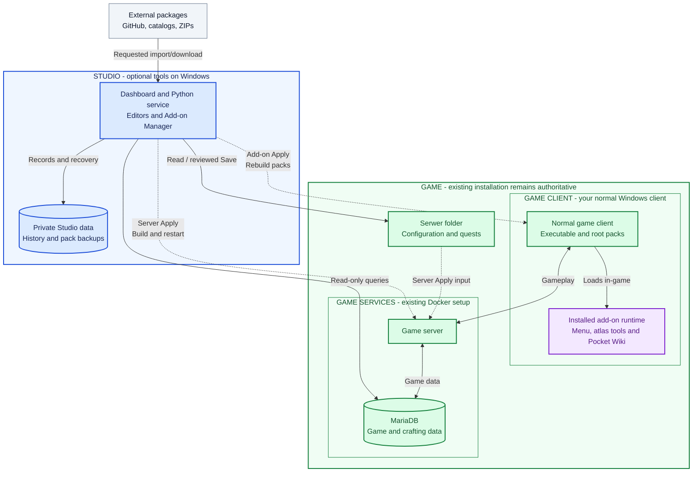
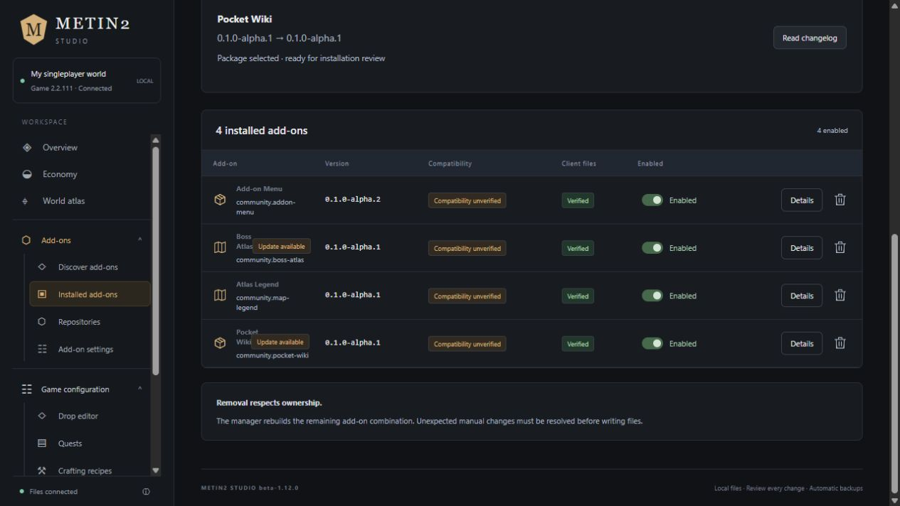
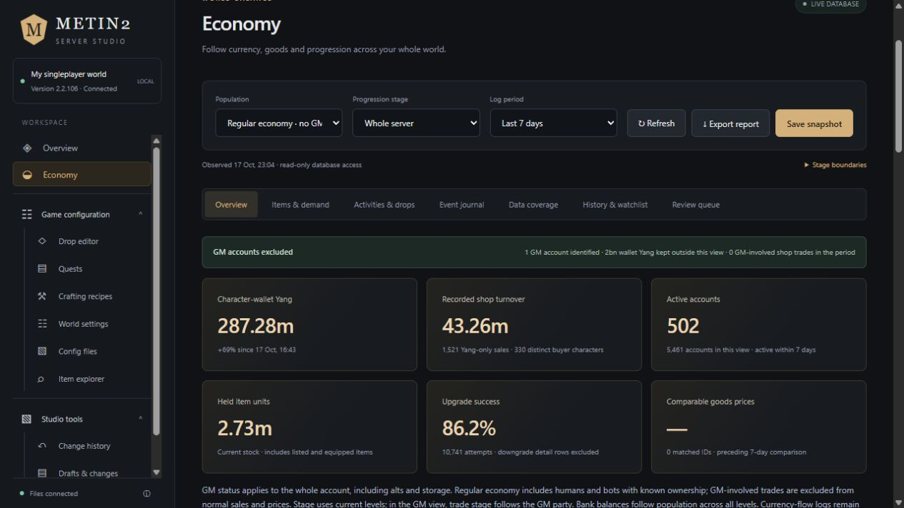
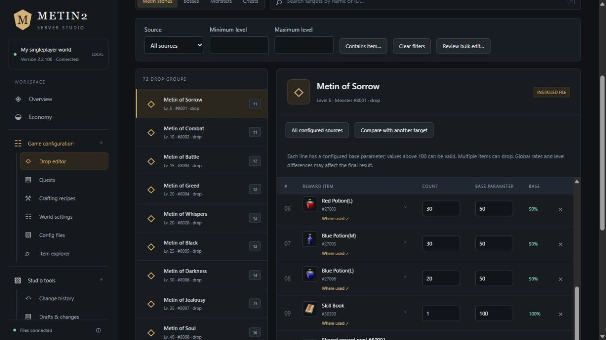
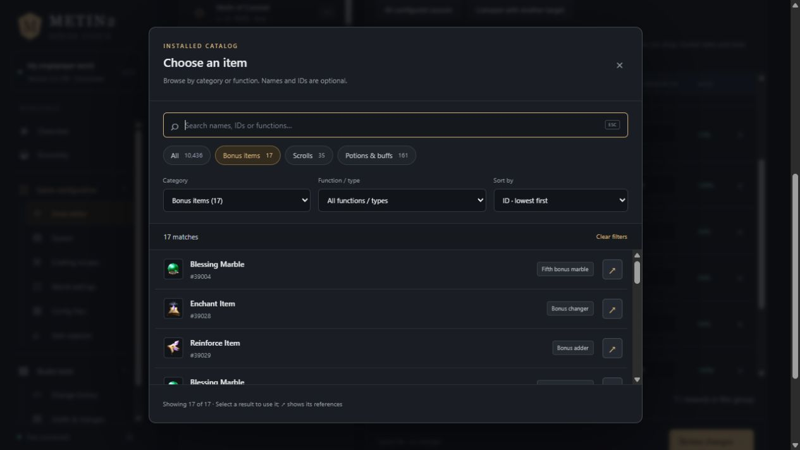
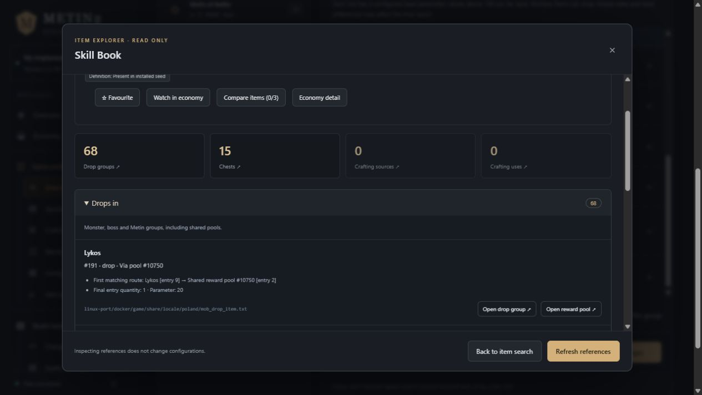
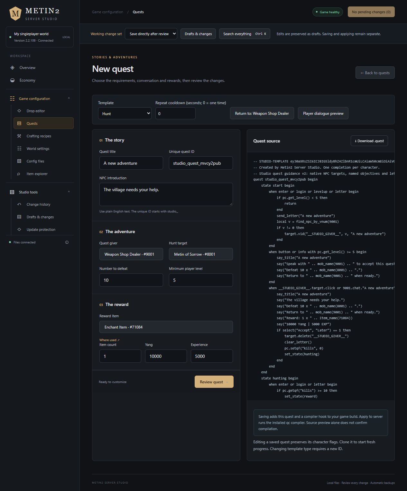
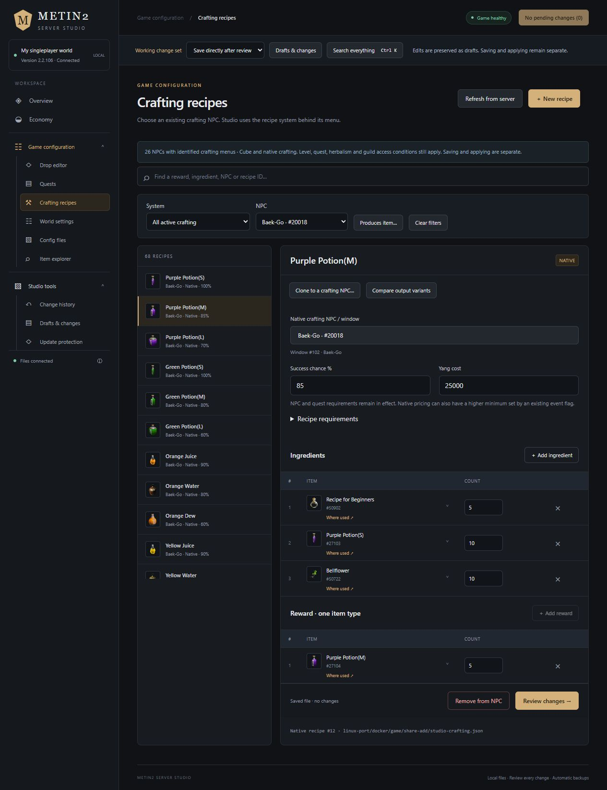
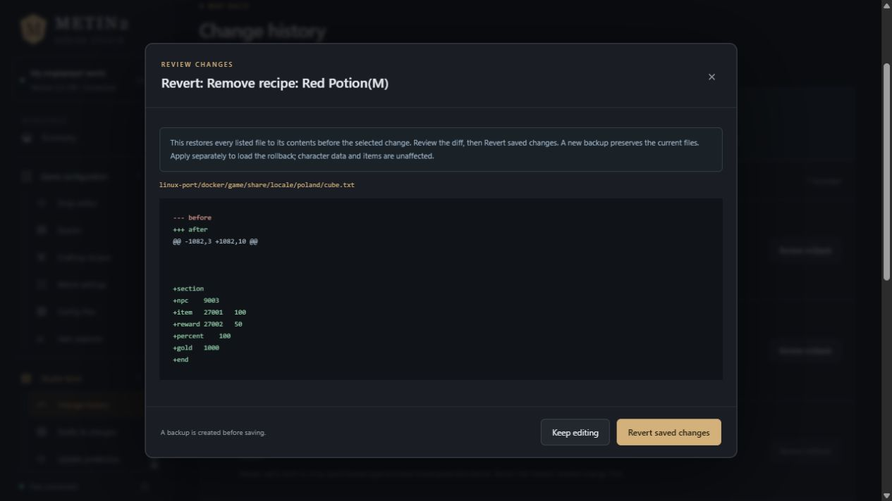

# Metin2 Studio

**beta-1.15.0** · A local dashboard for your Metin2 Singleplayer world and client add-ons.

Edit drops, create quests, manage crafting, explore items and follow the economy.
Add in-game tools such as Boss Atlas and Pocket Wiki through the same application.

[How to start](#how-to-start) · [Architecture overview](#architecture-overview) · [See what you can do](#see-what-you-can-do)

## How to start

You need **Windows 10/11**, **Python 3.10+**, and an existing working
**Metin2 Singleplayer Linux/Docker installation**.

1. Extract Studio into its own permanent folder outside the game's `Serwer` folder.
2. Run **Install Studio.bat** and select your existing **Serwer** folder.
3. Run **Start Studio.bat**, or use the **Metin2 Studio** desktop shortcut.

The dashboard opens at **http://127.0.0.1:8765** by default. Keep using the game's
normal launcher to start your world. **Stop Studio.bat** closes Studio.

See the [setup guide](docs/GETTING_STARTED.md) for compatibility, alternate ports,
PowerShell setup, your first edit and troubleshooting.

## Architecture overview

Studio runs beside the game, with its own dashboard, Python service and private
data folder. It reads your existing installation and applies reviewed changes to
server files or client packs. The game keeps its launcher, client and Docker services.

**Blue:** Studio · **Green:** game · **Purple:** installed add-on code · **Grey:** package sources.
The group labels also identify these boundaries.

Server edits follow **Review → Save → Apply**. Client add-ons use a separate
**Review → Apply** flow. Closing Studio leaves the game and installed add-ons
running. Game updates take priority over custom changes.

Read the [architecture and storage guide](docs/ARCHITECTURE.md) for operation
boundaries and databases, or [updates and backups](docs/UPDATES_AND_BACKUPS.md)
for preserving your work.

## See what you can do

Real dashboard captures from an installed world. Item names, available recipes and economic values depend on your game package and saved world. Expand an example to see its editor; click any image to view it at full size.

**Add tools inside your normal game client.** Choose which bundled add-ons to install:

| Add-on | What it adds |
| --- | --- |
| **Add-on Menu** | One in-game button for opening your installed extensions. |
| **Boss Atlas** | Configured boss and Metin spawn areas on the game's atlas. |
| **Atlas Legend** | Labels explaining the configured atlas overlays. |
| **Pocket Wiki** | Searchable crafts, upgrades, item sources and uses, with bookmarks and pinned recipes. |

Install or update a group with one review and one apply, then reopen the game
client once. Studio verifies installed files and flags add-ons that need reinstalling.
Installed add-ons work with Studio closed. The [add-on guide](docs/ADDONS.md)
covers installation, controls, settings, updates and creating your own extensions.
The browser's **World atlas** also links configured spawns to their drop editors
and saved map files.

**Follow the economy across progression stages.** Separate GM accounts, inspect Yang, item stock, recorded sales and upgrade activity, then export a report. Coverage notes explain what the existing game data can establish.

<strong>Edit Metin, monster and chest drops</strong>

Choose a target, adjust reward items, quantities and base parameters, inspect shared pools and review changes before saving. A base parameter is not always the final in-game drop probability.

<strong>Find the right item without knowing its ID</strong>

Filter by category or function: bonus changers, bonus adders, scrolls, potions, materials and more. Search by name or ID when useful; hover an item for its description.

Studio loads current server definitions and client names/icons, keeps them in sync after updates, and retains a private cache for offline browsing. Browse installed definitions by default, or switch to the full catalogue. [Catalogue sources and limits](docs/ITEM_CATALOG.md).

<strong>Check where an item is already used</strong>

Open **Where used** from a reward or the catalog to inspect its configured drops, crafting and other indexed references before adding another source.

<strong>Create a quest with guided fields</strong>

Choose a hunt, item turn-in or exchange template. Select the NPC, objectives, requirements, rewards and repeat cooldown; inspect the generated quest source and dialogue preview before saving. New quests add opt-in server-side scripts and require compilation during Apply.

<strong>Manage crafting at existing NPC menus</strong>

Filter by NPC, edit ingredients, output quantities, success chance and Yang cost, or create and clone recipes. Studio selects the existing Cube or native crafting system for that menu. This example shows Baek-Go's native potion recipe.

<strong>Review a rollback before confirming it</strong>

Select a saved change in **Change history**, inspect its before/after diff and decide whether to revert. Confirmation creates another backup; applying the reverted configuration remains a separate step. The capture shows a preview only.

<strong>Game updates take priority over custom changes</strong>

Compare the original, your custom value and the incoming game value for tracked edits. Package installation uses the game value first and preserves custom work in a pending merge review. Conflicts default to the game value. Afterwards, choose **Review selected merge** to keep game values or reapply selected custom changes, or **Keep game; decide later** to build/play the update with the review still pending. Compatible custom changes can be selected in the later review; nothing is merged automatically during package installation. Files absent from the package are left alone.

The [operator guide](docs/USER_GUIDE.md) explains each editor and its coverage.
Browse [all documentation](docs/README.md) for add-on development, project layout,
testing, releases and support. [MIT license](LICENSE).
